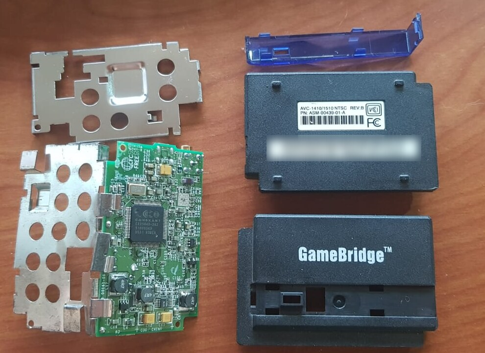
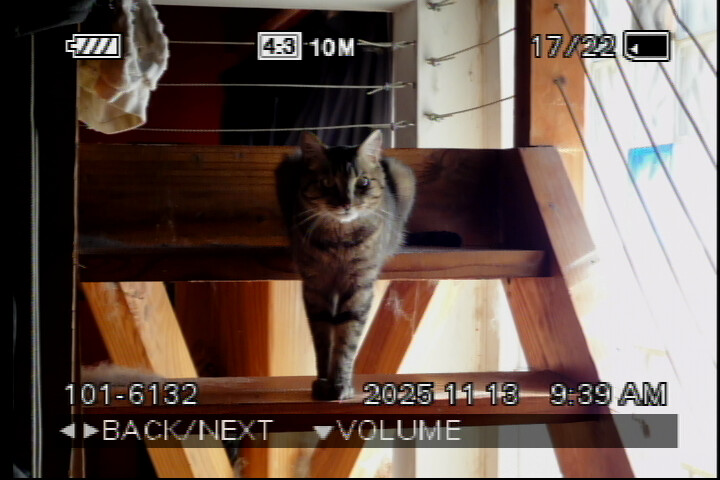
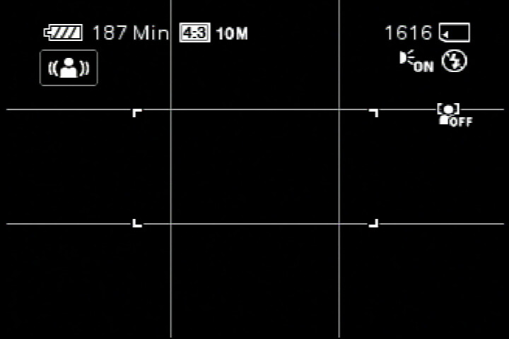
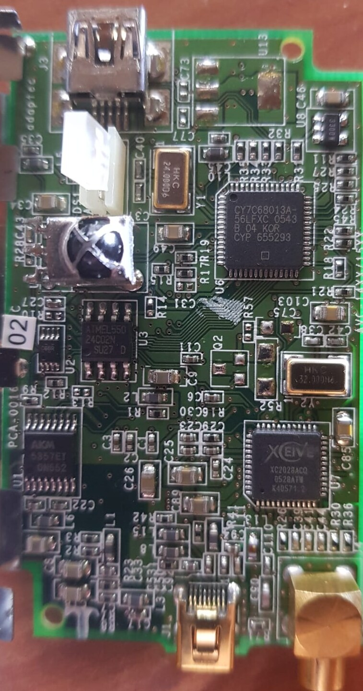
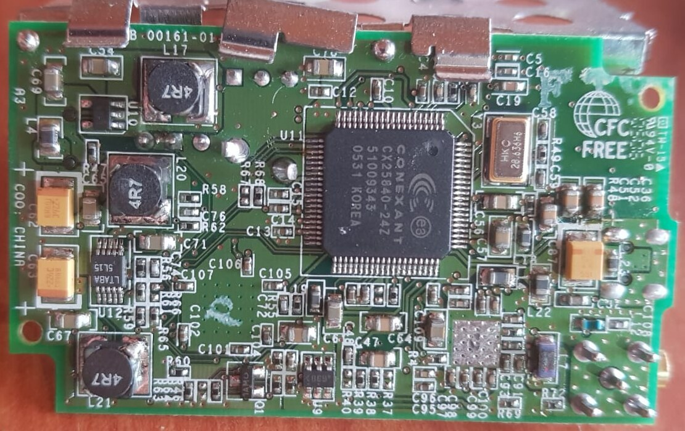
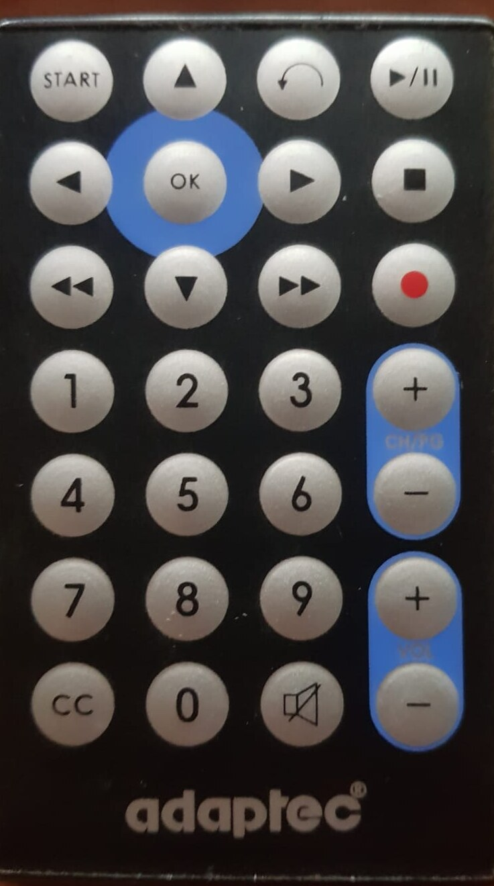

# gamebridge

Linux support for the **Adaptec GameBridge AVC-1410/1510** (USB `03f3:009b` →
`03f3:009c`), a 2004-era USB 2.0 analogue capture device that has never had a
driver (as far as I know) on any platform other than Windows XP.

You plug a games console or a VCR into one end and a PC into the other, and the
picture appears on your screen - fast enough to play on.

## Why it is worth the trouble

Most USB capture boxes of its day compressed the picture before sending it:
USB 2.0 is barely fast enough for raw video, so they carried an MPEG encoder,
and encoding on the box and decoding on the PC costs a sizeable fraction of a
second. Fine for recording a tape; no good for a game.

The GameBridge does not compress. It sends the decoder's raw picture, 720×480
at about 30 frames a second, **line by line as it is decoded** - the board has
no frame memory to hold a picture back in. To fit uncompressed video through,
it reserves 24 MB/s of USB bandwidth, within 2% of the most a USB 2.0 device
can reserve. That is what made it possible to play the consoles of its time on
a PC monitor (a Wii, in my case).

This driver keeps that property. It hands each frame to the application
**0.05 ms** after the frame's last line arrives (median over 600 frames,
measured with `tools/gblat`). The rest of the delay belongs to the player,
which is why the quick start below turns the player's buffering off.

With the driver loaded, Linux sees the GameBridge as a standard video device
with a microphone - and the remote control in the box works too.

<p align="center">
  
</p>

## Status

**A Linux kernel driver: picture, sound and the remote control, on NTSC and
PAL.** With `gamebridge.ko` loaded the device is an ordinary camera
(`/dev/videoN`), microphone (ALSA card `GameBridge`) and IR remote, usable from
ffmpeg, OBS, a browser or anything else that opens one.

| | |
|---|---|
| Driver | out-of-tree V4L2 + ALSA + rc-core module; uploads the firmware itself on plug-in |
| Builds | mainline 6.16 and 7.2, and RHEL 9's 5.14, clean at `W=1` |
| Tested | this release under KASAN, lockdep and PROVE_RCU on mainline 7.2.7 (UBSAN too) and on RHEL 9's 5.14, plus `v4l2-compliance` 84/84 (all xHCI); earlier versions on 6.16 and 6.19 (EHCI) |
| Video | 720×480 NTSC / 720×576 PAL, UYVY, ~30 and ~25 fps |
| Frame completeness | **every** row, every frame (480/480, 576/576) |
| Vertical stability | 0.04 rows NTSC, 0.09 rows PAL - a twentieth of a scanline |
| Colour | correct, verified against a known-good source |
| Audio | **48 kHz 16-bit stereo**, live, correctly channel-ordered |
| Remote | the original 28-button remote, as ordinary key presses |

<p align="center">
  
  
</p>

*Left: one frame captured through the driver, unscaled - a camera playing back
a photo of one of my cats (Avocato). Right: the control image, decoded from
`captures/samples/bt656-osd-slice.raw` by `gbcap decode` (the same assembler
the driver runs): the camera's on-screen display with its sensor covered. On
black, a missing line, a torn field or a frame that jumps would be easy to see,
so a picture like this is what the line count and stability figures above
were measured on.*

Not done:

- **The tuner.** Analogue broadcast is dead. The XC2028 loads and reaches its
  active state, but I haven't tried tuning an RF signal yet, so it is off by
  default (enable it with `tuner=1`). See `docs/internals/tuner.md`.
- **Packaging.** No DKMS package yet; rebuild after a kernel update.
- **Upstreaming.** Blocked on firmware redistribution; see `NOTICE`.

## Quick start

```sh
./tools/fetch-firmware.sh      # pull Adaptec blobs (not redistributed here)
python3 tools/extract-fw.py firmware/avcgbfl.sys firmware/gb-loader-fw.bin
make -C driver
sudo make -C driver firmware install
sudo modprobe gamebridge       # then plug the device in

ffplay -f v4l2 -input_format uyvy422 -video_size 720x480 \
       -fflags nobuffer -flags low_delay -framedrop -i /dev/videoN
arecord -D hw:CARD=GameBridge -t raw -f S16_BE -r 48000 -c 2 out.raw
```

`docs/guide/driver.md` has the details: building for another kernel, Secure
Boot, standards and inputs, the remote, module parameters.

The firmware upload is volatile: it goes to the FX2's internal RAM, never the
EEPROM, so the driver repeats it on every plug-in.

The userland tools in `tools/` came first and still work without the module:
`gbfw load` wakes the device, `gbplay.sh` plays picture and sound straight from
libusb. They are the bring-up and diagnostic path, documented in
`docs/guide/README.md`. **No hardware is needed to work on the frame
assembler:** `gbcap decode <rawfile>` replays a saved capture through the same
code the driver runs, and `captures/samples/` holds two.

## How it was done

### Empty when you plug it in

The device is a **Cypress EZ-USB FX2LP** bridge in front of an analogue video
decoder. It ships with a "C0" EEPROM, meaning the EEPROM supplies only the
USB VID/PID while the 8051 core is held in reset with no firmware. Until
firmware is uploaded the device is inert: it enumerates as `03f3:009b`, presents
the FX2's generic built-in descriptors, and reveals nothing about the capture
hardware. Every previous attempt to look at this device on Linux was looking at
that empty shell (took me a while to figure that out in those days).

### The firmware was hidden inside the Windows driver

The Windows driver's first act was to pour a small program into that empty
chip. The program is about seven and a half kilobytes, and it was not one of
the files on the driver CD: it is stored inside the driver binary itself, as
Cypress hex records in its data section.

The wake-up is temporary by choice. The firmware goes into RAM that clears when
the device is unplugged, never into the EEPROM: burning it in is a one-way
operation on a device that cannot be replaced (and it would not fit anyway: the
EEPROM holds 256 bytes). Details:
[`docs/internals/README.md`](docs/internals/README.md).

### Opening the case

The chips carry printed part numbers, and reading them off the board settled
what hardware I needed to support. The important one is a **Conexant CX25840**
video decoder, which Linux has driven since 2005 for other products.
Alongside it: an Xceive XC2028 TV tuner, an AKM AK5357 stereo audio converter
and a 24C02 EEPROM.

<p align="center">
  
  
</p>

*Top side (left): the Cypress FX2LP USB bridge, the Xceive XC2028 tuner, the AKM
AK5357 audio converter, the 24C02 EEPROM and the IR receiver. Bottom side
(right): the Conexant CX25840 decoder.*

### Watching the original driver work

Windows XP ran in a virtual machine with the GameBridge passed through, and
every command the Windows driver sent to the device was recorded while it
showed a picture: over three thousand of them, mostly status polls, with 488
register writes to the decoder among them. That recording is how the start-up
sequence was learned.

### The sound was inside the picture

The obvious assumption was that sound would arrive on its own connection. It
does not: **the audio is embedded in the video stream's horizontal blanking**,
the gaps between picture lines - 48,000 samples a second, 16-bit stereo. That is
normal in professional video equipment and unusual in a consumer box from 2004,
which is why I had no luck before.

### Remote control



The remote was the one feature with no vendor implementation to work from:
Adaptec's driver has no IR support at all. The receiver turned out to be a
command that had been in the recording since the first week, polled 2,563 times
and mistaken for a counter - because I never pressed a button while it was
recording. All 28 buttons are now ordinary Linux key presses.

<br clear="right">

### Tested as if it could break something

The driver ran three times on a deliberately hostile test setup: a debug build
of Linux that checks every memory access and every lock, with the device
unplugged mid-stream, streams started and stopped hundreds of times, and sound
and picture switched on and off underneath each other. The first run found the
bug behind the hard lockups; the other two, on the code in this release and on
two different kernels, came through with no fault reported. On the way it also
explained why the front light kept blinking after the picture stopped: the stop
command was being acknowledged and then silently dropped, so the device really
did keep streaming. `SECURITY.md` has the details (if you are curious).

### Is this legal?

This is interoperability work on hardware that is owned outright, using driver
files the manufacturer published. The manufacturer's firmware runs the device
it was written for; it is not copied into or shipped with this project. See
`NOTICE`.

## Documentation

- [`docs/guide/driver.md`](docs/guide/driver.md) - building, installing and using the kernel driver
- [`docs/guide/README.md`](docs/guide/README.md) - the userland tools, and the USB protocol as understood
- [`docs/guide/v4l2loopback.md`](docs/guide/v4l2loopback.md) - using the device as a webcam without the driver
- [`docs/internals/`](docs/internals/README.md) - hardware, firmware, the command set, the remote, the tuner, Adaptec's INF
- [`docs/cx25840-registers.md`](docs/cx25840-registers.md) - the decoder's registers by address and name
- [`docs/roadmap.md`](docs/roadmap.md) - what is done and what is next
- [`captures/`](captures/) - the recorded Windows session, the replay scripts and two raw sample streams
- [`SECURITY.md`](SECURITY.md) - attack surface, and how the driver was tested

## Credits

By Ivan Barrera (Bruce), in my home lab, with the support of Claude Code -
especially with the disassembly and security reviews.

The driver stands on the Linux media subsystem: the in-kernel `cx25840` driver
does the decoder's real work, and `usbtv` and `stk1160` were the models for its
structure (see `NOTICE`).

## Licence

GPL-2.0 - see `LICENSE`. Every source file carries an SPDX identifier, and the
kernel module declares `MODULE_LICENSE("GPL")`. `driver/xc2028.h` is an excerpt
of the Linux kernel's own header and keeps its upstream copyright; `NOTICE`
lists what is not original work.

The Adaptec firmware is **not** in this repository and is not redistributed.
`tools/fetch-firmware.sh` downloads Adaptec's original driver package and
`tools/extract-fw.py` extracts the firmware locally, on the machine that will
use it. "Adaptec" and "GameBridge" are trademarks of their respective owners;
this project is not affiliated with or endorsed by Adaptec or its successors.
